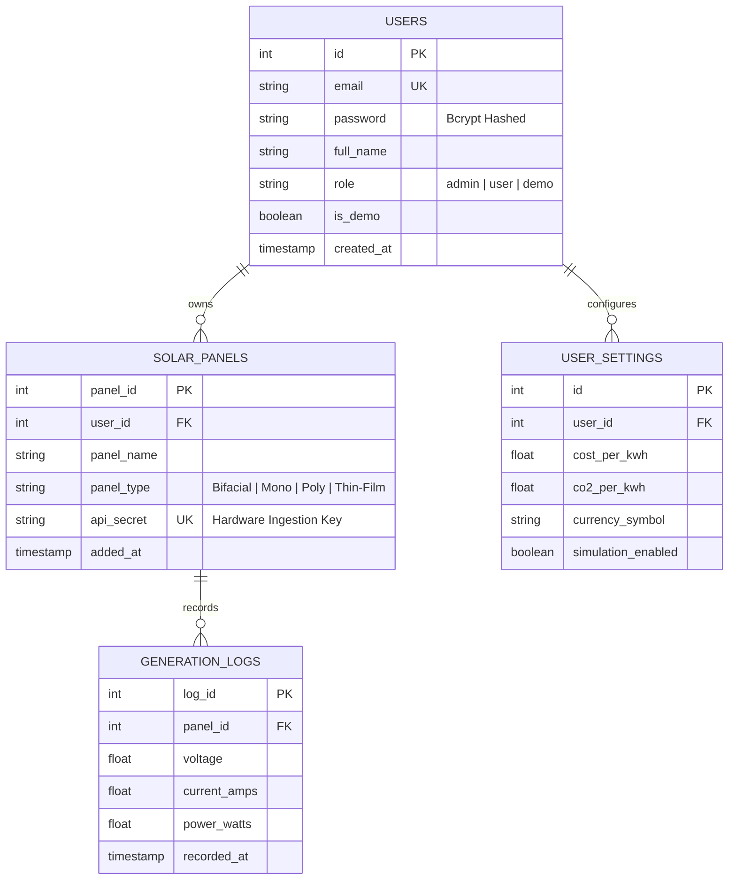

# HeliosTrack Architecture & Data Flow Manual

This document details the architectural evolution, data boundaries, and network topology of **HeliosTrack Version 2.4**.

---

## 1. How It Worked (v1.0) vs. How It Works Now (v2.4)

| Dimension | Legacy HeliosTrack (v1.0) | Modern HeliosTrack (v2.4) |
| :--- | :--- | :--- |
| **Tenancy & Access** | **Single Admin Only** (`ADMIN_EMAIL` in `.env`). Visitors were blocked by a login screen with no way to register or demo. | **True Multi-Tenant SaaS & Instant Showcase**. Visitors can click **"1-Click Live Demo"** to explore immediately, or register a private account. |
| **Data Isolation** | **Global / Shared**. All panels and logs were queryable without tenant filtering. | **100% Isolated**. `solar_panels` and `generation_logs` are foreign-keyed to `users(id)`. Every query runs `WHERE user_id = req.user.userId`. |
| **Real-Time Streaming** | **Global Broadcast**. WebSocket emitted `io.emit('live_log_update')` to every connected client in the world. | **Targeted Private Rooms**. Handshake binds sockets to `user_${userId}` rooms. Telemetry is routed exclusively to the string owner. |
| **Telegram Notifications** | **Global Admin Spam**. The bot messaged the admin for every panel in the database (including test/demo panels). | **Filtered & Scoped**. The bot alerts the admin **only** for the admin's personal panels (`user_id = 1`), keeping the admin's personal phone silent for demo/stranger accounts. |
| **Frontend Framework** | Static HTML, jQuery, DataTables, SweetAlert2, and CDN scripts. | **Next.js 16 (App Router)**, React 19, TypeScript, Tailwind CSS 4, and custom SVG charting. |
| **Offline Resilience** | Showed raw `Failed to fetch` if backend was offline or sleeping. | **Zero-Failure Fallback Engine**. Automatically switches to an internal microgrid telemetry engine if backend is sleeping. |

---

## 2. End-to-End Topology & Data Flow ("Which Connects to Which")

```mermaid
flowchart TD
    subgraph IoT Fleet Layer [IoT Hardware & Fleet Simulator]
        HW["Physical ESP32 / Arduino Sensors"]
        SIM["Multi-Process Virtual IoT Simulator"]
    end

    subgraph Ingestion Layer [Express 5 API Engine (Port 3001)]
        INGEST["POST /api/logs (x-api-key Header)"]
        AUTH_ROUTER["Auth Controller (/api/auth/*)"]
        PANEL_ROUTER["Fleet Controller (/api/panels)"]
        AUDIT_ROUTER["Audit Controller (/api/logs/*)"]
    end

    subgraph Data Layer [TiDB Serverless Cloud (MySQL)]
        USERS[("users table")]
        PANELS[("solar_panels table")]
        LOGS[("generation_logs table")]
        SETTINGS[("user_settings table")]
    end

    subgraph RealTime Layer [Socket.io Room Routing]
        ROOM_ALICE["Room: user_alice"]
        ROOM_BOB["Room: user_bob"]
        ROOM_DEMO["Room: user_demo"]
    end

    subgraph Presentation Layer [Next.js 16 Frontend (Port 3000)]
        UI_ALICE["Alice Dashboard (Alice Strings Only)"]
        UI_BOB["Bob Dashboard (Bob Strings Only)"]
        UI_DEMO["Guest Showcase Sandbox"]
    end

    subgraph Alert Layer [Telegram Bot Gateway]
        TG_BOT["Telegram Bot API"]
        ADMIN_PHONE["Admin Personal Telegram Chat"]
    end

    %% Ingestion Flow
    HW -->|Sends Volts/Amps with x-api-key| INGEST
    SIM -->|Simulates Volts/Amps with x-api-key| INGEST

    INGEST -->|1. Validate Secret & Lookup Owner| PANELS
    PANELS -->|Resolves user_id| USERS
    INGEST -->|2. Insert Telemetry Record| LOGS

    %% Scoped WebSocket Dispatch
    INGEST -->|3. Route Telemetry to Owner Room| ROOM_ALICE
    INGEST -->|3. Route Telemetry to Owner Room| ROOM_BOB
    INGEST -->|3. Route Telemetry to Owner Room| ROOM_DEMO

    ROOM_ALICE -->|Live 5s Event| UI_ALICE
    ROOM_BOB -->|Live 5s Event| UI_BOB
    ROOM_DEMO -->|Live 5s Event| UI_DEMO

    %% Telegram Alert Scoping
    INGEST -->|4. If user_id == 1 AND Voltage < 20V or > 25V| TG_BOT
    TG_BOT -->|Alerts Admin Only for Admin Panels| ADMIN_PHONE
```

### Detailed Step-by-Step Flow:

1. **Ingestion & Authentication (`POST /api/logs`)**:
   - An IoT sensor (or the background simulator) makes a POST request to `/api/logs` with headers:
     `Content-Type: application/json` and `x-api-key: <unique_panel_secret>`.
   - The server queries `solar_panels` matching both `panel_id` AND `api_secret`.
   - If invalid: rejects immediately with `403 Forbidden`.
   - If valid: extracts `user_id`, `panel_name`, and `panel_type`.

2. **Database Storage**:
   - The electrical telemetry (`voltage`, `current_amps`, `power_watts`) is inserted into `generation_logs` with a server timestamp `NOW()`.

3. **Targeted Real-Time WebSocket Dispatch**:
   - Instead of broadcasting globally, the server dispatches:
     ```javascript
     io.to(`user_${panel.user_id}`).emit('live_log_update', liveLogObject);
     ```
   - Only sockets connected with a JWT belonging to that specific `user_id` receive the update.
   - Alice's browser receives Alice's updates; Bob's browser receives Bob's updates.

4. **Telegram Alert Routing & Scoping**:
   - When a voltage anomaly is detected (< 20.0V drop or > 25.0V spike):
     - The server checks if `panel.user_id === 1` (Admin's personal fleet) and `!panel.is_demo`.
     - If true: it checks the 5-minute per-string cooldown (`ALERT_COOLDOWN_MS = 300000`) to prevent alarm fatigue, then messages your `TELEGRAM_CHAT_ID`.
     - If the anomaly belongs to a stranger account or demo sandbox: your personal phone is **not paged**.

---

## 3. Microgrid Mathematical & Physical Models

### 1. Energy Generation Calculation
Telemetry samples arrive every 5 seconds ($t = 5\text{ s}$):
$$\Delta t = \frac{5}{3600} \approx 0.001389 \text{ hours}$$
$$\text{Energy Increment (kWh)} = \frac{\text{Power (Watts)}}{1000} \times \Delta t$$
$$\text{Session Yield (kWh)} = \sum \text{Energy Increment}$$

### 2. Financial ROI Savings
$$\text{Monetary Savings (\$)} = \text{Session Yield (kWh)} \times \text{Tariff Rate (\$/kWh)}$$
*(Default Tariff: \$0.16/kWh, customizable in `user_settings`).*

### 3. Carbon Emissions Avoidance
$$\text{CO}_2 \text{ Offset (kg)} = \text{Session Yield (kWh)} \times 0.42\text{ kg CO}_2/\text{kWh}$$

### 4. Battery Kinetics & Utility Grid Infeed Trigger
* **Battery State of Charge (SOC)**:
  $$\Delta \text{SOC} = \left(\frac{\text{Solar Watts}}{1000} \times 0.35\right) - \text{Internal Parasitic Drain}$$
* **Grid Export Condition**:
  $$\text{If } \text{SOC} \ge 99.0\% \text{ and } \text{Solar Output} > \text{Facility Demand}:$$
  $$\text{Grid Export (kW)} = \frac{\text{Solar Output} - \text{Facility Demand}}{1000} \quad (\text{Status: Selling Green Power to Grid 💸})$$
  $$\text{Else}: \text{Synchronized (Zero Grid Infeed)}$$

---

## 4. Database Schema Specification



---

## 5. Security & Isolation Defenses

1. **Anti-Brute Force Rate Limiter**: Maximum 10 failed login attempts per 15-minute window per IP.
2. **Bcrypt Timing-Leak Elimination**: Uses a dummy hash comparison when an email is not found to prevent user enumeration attacks.
3. **CSV Formula Injection Sanitization**: All exported strings are escaped to prevent spreadsheet execution (`="cmd|..."`).
4. **Hardware Key Randomness**: Cryptographically pseudorandom alphanumeric strings (`helios_key_...`).
